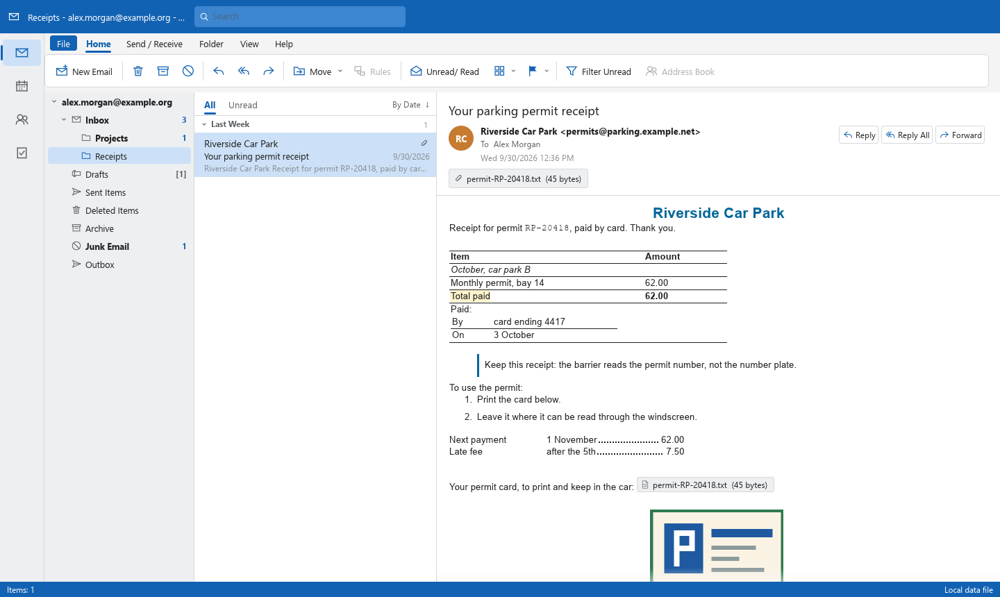

# OpenMailClient


A clean-room, open-source mail client written in Rust, aiming at parity with Microsoft Outlook Classic
(the Win32 desktop Outlook): the same layout and behaviour, files that go both ways, and every feature
reachable as a command from the UI, a CLI and (later) an MCP server.

OpenMailClient is an independent concept project. It is not affiliated with Microsoft. It follows the
conventions of [`storytold/wordcraft`](https://github.com/storytold/wordcraft).



*The sample mailbox (invented content), drawn by `ui_shot`. The receipt is stored only as RTF.*

## Progress

The numbers are measured, not estimated: [ROADMAP.md](ROADMAP.md) has the headline numbers and the
progress log, [docs/parity-checklist.md](docs/parity-checklist.md) is generated from the feature
catalog, and [docs/gaps.md](docs/gaps.md) ranks what is missing.

### Milestones

| | Milestone | State |
|---|---|---|
| M1 | **Data files first**: open `.pst`/`.ost`/`.msg`/`.eml` in an Outlook-Classic-style window; save messages Outlook can reopen |  |
| M2 | **Formatted reading**: HTML and RTF bodies laid out and drawn, pictures, printing |  ([do later](ROADMAP.md#do-later-from-m2)) |
| M3 | **Writing `.pst`**: a mailbox saved as a `.pst`, changes to an open one kept, settings kept |  ([do later](ROADMAP.md#do-later-from-m2)) |
| M3b | **The do-later batch**: journalled changes, a save into the data file where it is, and what M2 and M3 left |  |
| M3c | **Proof in Outlook, 4K-page writing**: files we write open in Outlook Classic (done); 4K-page data files written |  |
| M4 | **Accounts**: IMAP, POP3 and SMTP |  |
| M5 | **Calendar, People and Tasks** |  |
| M6 | **MCP server, control channel, web build** |  |

Closed milestones still have work left over: it is not dropped. Each piece is a row in
[Do later](ROADMAP.md#do-later-from-m2) with the slot it lands in, and is struck when it lands.
42 rows are done; 33 are open: 6 in M3c, 2 in M4, 15 in M5, 1 in M6, 2 with M1's checks against
Outlook, and 7 that wait on something we do not have yet (an Outlook-written file of a kind we may
read, a reader we can try without driving a window, a printer we may use).

### Outlook Classic features with a command

| Area | Done | | |
|---|---|---|---|
| Mail | 32 of 67 | `██████████░░░░░░░░░░` | 48% |
| File | 8 of 14 | `███████████░░░░░░░░░` | 57% |
| Message window | 4 of 17 | `█████░░░░░░░░░░░░░░░` | 24% |
| Calendar | 0 of 9 | `░░░░░░░░░░░░░░░░░░░░` | 0% |
| People | 0 of 5 | `░░░░░░░░░░░░░░░░░░░░` | 0% |
| Tasks | 0 of 5 | `░░░░░░░░░░░░░░░░░░░░` | 0% |
| **All** | **44 of 117** | `███████░░░░░░░░░░░░░` | **37%** |

### File formats and protocols

| | Read | Written |
|---|---|---|
| `.pst`, `.ost` (ANSI, Unicode, 4K pages) | yes | a whole mailbox as a new Unicode or ANSI `.pst`; changes to an open Unicode or ANSI `.pst` are kept by Save Changes, and the file stays the kind it was (Outlook Classic opens them and sees what was written) |
| `.msg`, `.oft` | yes | yes |
| `.eml` | yes | yes |
| `.pdf` | | yes, a message (Memo Style) or a folder's list (Table Style), printed |
| IMAP, POP3, SMTP | not yet (M4) | not yet (M4) |

## What works today

- Opens Outlook data files (`.pst`, `.ost`) and single messages (`.msg`, `.oft`, `.eml`). Nothing is
  written to a data file until Save Changes (Ctrl+S): changes to a Unicode or ANSI `.pst` are then written
  into the file where it is, so a flag on one message is a few pages and not the mailbox again. What a save
  writes over is kept beside the file until the save is checked and read back, and is put back if anything
  goes wrong, a power cut included; the first save keeps the file as it was beside it and writes a whole
  new file that is checked, read back and swapped in. Until then each change is journalled beside the file (or in a folder of our own when that
  one cannot be written), so a crash or a
  closed window does not lose it: it comes back, still unsaved, when the file is opened again.
  `.ost` and 4K-page files are read-only. A save or an export runs beside the window, with
  progress and a way to stop it, and a structure check (`inspect --check`) reads a data file
  through without changing it.
- An Outlook-Classic-style window: ribbon (simplified and classic), folder pane, message list with
  date groups, reading pane, light and dark themes.
- Read, flag, categorise, move, delete, archive, search, sort and filter in writable (in-memory) stores.
- Reply, reply all, forward and new mail as drafts; saving messages as `.msg`, `.oft` or `.eml`.
- **Formatted bodies.** HTML and RTF mail is laid out and drawn: fonts the message names (installed
  ones only), colours, lists, links, tables (cell borders, fills, merged cells, tables inside cells),
  paragraph borders and spacing, bordered and filled blocks inside one another, rounded corners, borders round
  text within a line, a colour behind the whole body, line spacing, tab stops, right-to-left text. Nothing in a message is run and
  nothing is fetched.
- **Pictures.** Attached and written-in pictures (PNG, JPEG, GIF, WebP, TIFF, SVG, bitmaps, Windows and enhanced metafiles
  that are drawings, with the bitmaps, hatched and patterned brushes and clipped regions in them) are decoded in-process and drawn in the text; animated GIF, PNG and WebP
  pictures are played, or stand still when asked (`view.animations`); pictures stand at the sides of
  a paragraph with the text beside them; an attachment that stands in the
  text is a card that a click saves.
- **Printing.** A message (Memo Style) or a folder's list (Table Style) prints to a PDF file, with
  tables, borders and pictures; a print window shows the pages beside the page setup (paper,
  direction, margins, header and footer) and has a zoom; Table Style prints the columns chosen,
  group headings and the selected row. Nothing is sent to a printer yet.
- A sample mailbox with invented content, for trying things without any real mail.

## What does not work yet

- **Sending and receiving.** There are no accounts. "Send" files the message in Outbox and stops.
- **Proof against Outlook.** `.pst` files written here open in Outlook Classic with every folder
  and message as written, whole, ANSI and saved into in place; a file written before M3c.1 must be
  exported once first. No Outlook-written `.pst` has been saved into yet. 4K-page data files cannot
  be changed (M3c, next).
- **Parts of formatted bodies.** Right-to-left text while it is typed; complex scripts
  on screen beyond what egui shapes; metafiles that copy with a mask or see-through; printing to a
  printer. Each is scheduled in
  [ROADMAP.md](ROADMAP.md#do-later-from-m2).
- Calendar, People and Tasks.
- The MCP server, the control channel and the web build.

## Run it

```bash
cargo run --release -p openmailclient -- --sample
```

```bash
cargo run --release -p openmailclient -- path/to/archive.pst
```

The page setup, the panes and their sizes, the window's size and place, the theme and the data files that were open are kept between runs in
`settings.json` in the per-user configuration folder (`%APPDATA%\OpenMailClient` on Windows) and
the data files are opened again when a run names none. To start without it:

```bash
cargo run --release -p openmailclient -- --no-settings
```

Without a window:

```bash
cargo run --release -p openmailclient-cli -- inspect path/to/archive.pst --check
```

```bash
cargo run --release -p openmailclient-cli -- convert message.msg message.eml
cargo run --release -p openmailclient-cli -- convert mailbox.ost copy.pst
```

A screenshot of the real UI without opening a window:

```bash
cargo run --release -p openmailclient-ui-egui --example ui_shot
```

## Safety rules the code follows

- **Never crash, never lose mail.** No panics in non-test code; every reader has a hostile-input test;
  a data file is not written to until a save is asked for; a save writes a temporary file, checks it and swaps it in, or writes into the file with an undo file beside it that puts it back byte for byte if the save does not end.
- **Mail is hostile and private.** Message content is data: nothing in a message is run, and remote
  content is never fetched. Attachments are only ever saved to a file you choose.
- **Clean room.** Formats come from public specifications ([MS-PST], [MS-OXMSG], RFC 5322, …). No
  Microsoft code, icons, fonts or wording; icons are drawn in code.

Details: [CLAUDE.md](CLAUDE.md).

## Development

```bash
cargo xtask ci
```

runs formatting, clippy with warnings denied, the tests, and the asset, layering, parity and wasm checks.

## Licence

MIT or Apache-2.0, at your option.
